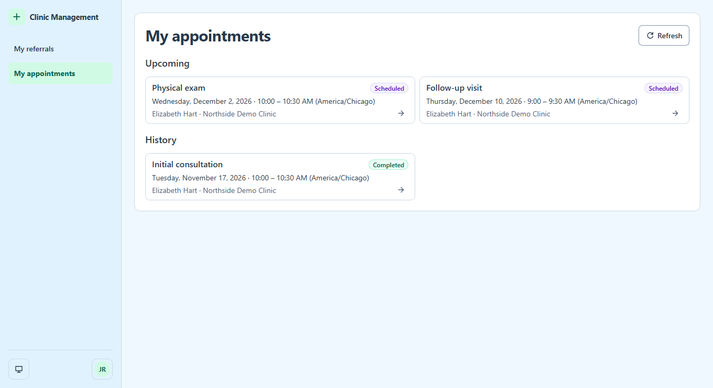
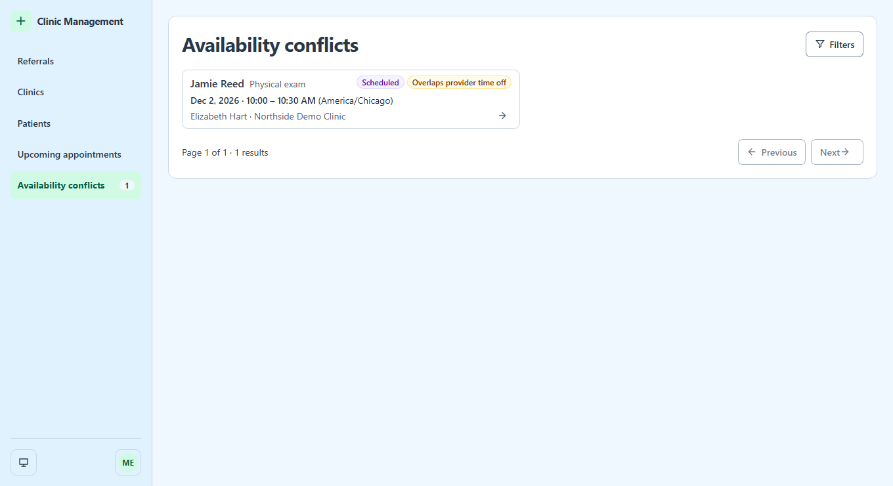
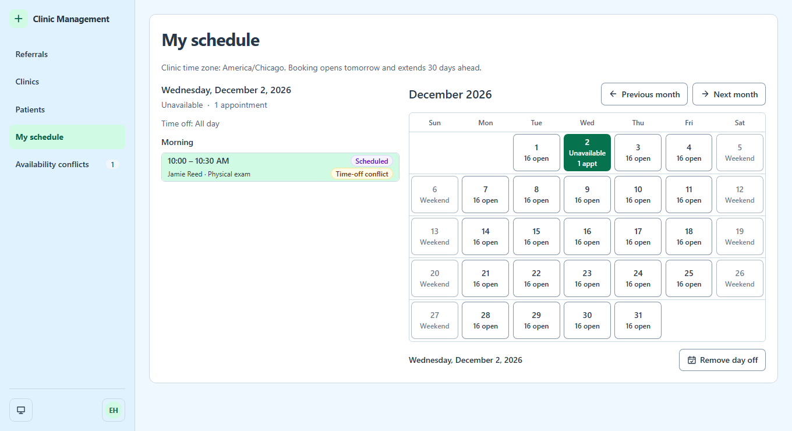

# Try Clinic Management

## Create your private workspace

1. Open the [live demo](https://clinic-demo-quan.westus2.cloudapp.azure.com). To run it on your machine, follow the [Docker setup](setup.md#run-locally-with-docker-compose).
2. Select **Sign in with username and password**, then select **Sign up** on the Auth0 page.
3. Verify your email using the message from Auth0. If the app still shows **Verify your email**, select **Check verification**.
4. Select **Create my workspace**. The app opens a private copy of the fictional clinic records.
5. To return later, sign in with the same account to open your workspace.

## Try a workflow

Start in **Referrals** to review the demo queue. Open **Upcoming appointments**
and select **Create appointment** to try direct booking for a fictional patient.
Use **My schedule** to see the linked clinician’s availability and appointments.

To try a reschedule, open an appointment from **Availability conflicts** or
**Upcoming appointments**. Select **Reschedule**, choose an open day and time,
and select **Save new time**. Moving a conflicting appointment to an open slot
clears it from **Availability conflicts**. Each visitor works on their own
copy, so changes stay in that workspace.

## Role walkthroughs

These screenshots use fictional records to show how an appointment on a
provider’s day off appears to each role. Use your private workspace for the
hands-on booking and scheduling steps above.

### Patient

Jamie opens **My appointments** to see scheduled visits and appointment
history. Selecting a card shows the time, clinic, and provider. **My referrals**
shows the status of referrals and links to the booked appointment when one is
available.

### Front desk

The front desk opens **Availability conflicts** and selects Jamie’s card.
From the appointment details, **Reschedule** opens a calendar with available
days and times. After the front desk saves an open slot, Jamie’s appointment
moves to the new time and the conflict clears.

### Provider

Elizabeth opens **My schedule** and selects the day off. Her calendar shows
the existing appointment and its time-off conflict. She can also find it under
**Availability conflicts** and coordinate with the front desk. After the
reschedule, the appointment appears on the new date in her schedule.

